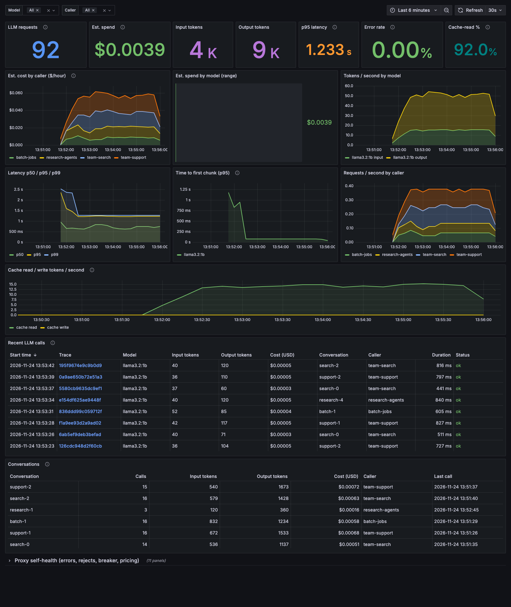

# llmspan

> **A reverse proxy that turns OpenAI-, Anthropic- and Gemini-compatible API traffic into OpenTelemetry traces, metrics and cost.** Point your SDK's base URL at it; no SDK and no changes to your application code, and no new backend: it exports standard OTLP to whatever you already run.



*The bundled Grafana dashboard, filled by `make demo-real`: real requests to a local llama3.2:1b through llmspan. Tokens, latency, time to first chunk and cache reads are measured; **cost uses an illustrative per-token rate** because local inference has no bill. `make demo` fills the same dashboard from a mock upstream with no model needed.*

`llmspan` is a single-binary Go reverse proxy for the OpenAI Chat Completions / Responses / Embeddings, Anthropic Messages and Google Gemini `generateContent` wire formats. It forwards your requests and relays the responses unchanged (streaming included), and out-of-band emits OpenTelemetry traces, metrics and logs following the [OTel GenAI semantic conventions](docs/SEMCONV-COMPLIANCE.md): tokens, cost from a price table, time to first token, finish reasons, and (opt-in, redacted) prompt content.

Send the output to anything that speaks OTLP: Grafana (Tempo/Prometheus/Loki), Honeycomb, Datadog, Jaeger, or an OpenTelemetry Collector.

> **Status:** pre-1.0. Config keys and metric/attribute names may change between minor releases; deprecations are listed in the [CHANGELOG](CHANGELOG.md). The GenAI semantic conventions themselves are still in Development.

---

## Why

Most LLM observability tools want you to adopt their SDK, their backend, or both. If you already run an OpenTelemetry stack, llmspan is the smallest thing that gets LLM calls into it. It works for any client that lets you set a base URL, including ones you can't modify, and it keeps data in infrastructure you already operate.

### Why a proxy

LLM calls are ordinary HTTP requests, and the OpenTelemetry GenAI semantic conventions now say what a trace and its metrics for one should look like. What's usually missing is the instrumentation: every language and framework needs its own SDK or wrapper, coverage is uneven, and the clients you most want visibility into (coding agents, vendor tools, scripts, notebooks) are often ones you don't control. A proxy sits at the one point every call passes through, so it sees all of them, and because the provider's response carries the token counts it can work out usage and cost from the wire format without knowing anything about the caller.

Because it sits on the path your API keys travel, llmspan is deliberately small and boring: one static binary, observe-only, no storage unless you turn on recording, and safe defaults (authentication, concurrency limits, circuit breakers, content capture off) rather than a long feature list. Where it can't see enough, such as tool calls, retries and agent logic, it says so and leaves that to in-process SDKs.

### What it's for

- **Clients you can't (or won't) instrument.** Coding agents, IDE plugins, vendor tools, notebooks and services in several languages: if it can set a base URL, it gets traces and metrics, with no SDK per language and no code change.
- **Who is spending what.** Cost and token usage per model and per caller (named tokens, mTLS identity, or a header you trust), cache-hit ratio, and the most expensive calls, as ordinary Prometheus/OTLP series you can alert on. Cost is an estimate from a [price table](docs/PRICING.md), not an invoice.
- **Latency and reliability from the client's side.** Time to first chunk, end-to-end latency, error and rate-limit rates by provider and model, joined to your application's trace when the client sends `traceparent`. Useful for spotting provider degradation and for SLOs you can't get from provider dashboards.
- **A place to look when a call goes wrong.** Per-call spans with status, tokens and finish reason; optional, redacted prompt and completion capture (off by default); conversation grouping, including in [Grafana Agent Observability](#send-to-grafana-cloud-agent-observability).
- **Capture and replay for tests.** Record real traffic to a redacted JSONL file and replay it against a staging or candidate endpoint with `llmspan replay` / `diff`.
- **One choke point for platform teams.** A single place that sees every LLM call, with auth, concurrency limits and circuit breakers in front of the provider. It forwards provider keys but does not store them. See [privacy limits](#privacy) before turning on content capture.

### How it compares

| | llmspan | Langfuse / Phoenix | Helicone | LiteLLM proxy | OpenLLMetry / OpenLIT | Grafana Agent Observability |
|---|---|---|---|---|---|---|
| Integration | base-URL proxy | SDK or OTLP ingest | base-URL proxy (or SDK) | gateway you route through | in-process SDK instrumentation | SDK, OTel GenAI spans, or coding-agent plugin |
| Destination | any OTLP backend | its own backend (self-host or cloud) | its own backend | callbacks to your choice | any OTLP backend | Grafana Cloud |
| Evals, prompt mgmt, session UI | no | yes | partly | partly | no | evals and guards |
| Sees agent steps (tools, retries) | no, only LLM calls | yes, via SDK | LLM calls | LLM calls | yes, in-process | yes, via SDK |
| Routing, key mgmt, fallbacks | no | no | partly | yes | no | no |

This table is a summary as of 2026-11 and is necessarily simplified; check each project's docs. **What you give up with llmspan:** it sees HTTP calls, not your agent's logic, so there is no eval framework, prompt management, dataset tooling or session UI. It is observe-only, not a gateway. It adds one network hop (see [measured overhead](docs/BENCHMARKS.md)) and is one more thing to run.

Not a good fit if you want routing and fallbacks (use a gateway such as LiteLLM) or in-process agent traces (use SDK instrumentation). It combines well with either: point the gateway's upstream traffic through llmspan, or use llmspan for the clients you can't instrument.

---

## Quick start (keyless)

### 30 seconds, no Docker

Needs Go (any recent version; the toolchain downloads the exact one the module needs). Build the binary, start the built-in mock upstream, and point llmspan at it. No API key, no collector; llmspan logs one line per call with tokens and cost.

```bash
go install github.com/llmspan/llmspan/cmd/llmspan@latest
export PATH="$PATH:$(go env GOPATH)/bin"            # go install puts the binary in ~/go/bin; skip if already on PATH
llmspan demo --listen 127.0.0.1:8080 &            # mock OpenAI-compatible upstream
cat > demo.yaml <<'EOF'
listen: 127.0.0.1:4000
upstreams:
  - name: openai
    prefix: /v1
    target: http://127.0.0.1:8080
    provider: openai
EOF
llmspan up --config demo.yaml &                    # with no collector it logs OTLP export warnings but keeps serving
curl -s localhost:4000/v1/chat/completions -H 'Content-Type: application/json' \
  -d '{"model":"gpt-5-mini","messages":[{"role":"user","content":"hi"}]}'
# llmspan log: msg="llm request completed" model=gpt-5-mini status=200 input_tokens=8 output_tokens=5 cost_usd=1.2e-05
```

### Full stack with dashboards (1-2 minutes, mostly image pulls)

Needs Docker. Same mock upstream, plus a small traffic generator and Tempo, Prometheus, Loki and Grafana.

```bash
git clone https://github.com/llmspan/llmspan && cd llmspan
make demo                      # first run pulls images (~100 s on a fresh VM); llmspan + mock upstream + traffic + Tempo/Prometheus/Loki/Grafana
open http://localhost:3000     # Grafana, anonymous admin: "LLM Observability — llmspan"
```

Panels fill in after a minute or two (rates need a few samples). Stop with `make compose-down`.

Want real model traffic instead of the mock? With [Ollama](https://ollama.com) running on the host (`ollama serve`, `ollama pull llama3.2:1b`), `make demo-real` sends varied prompts to it through llmspan, so token counts, latency, streaming time to first chunk and cache reads are real measurements. Cost uses an illustrative rate in `deploy/compose/prices-local.yaml`, since local inference has no price. The model runs on the host, not in a container, because Docker Desktop has no GPU access. The stack is plaintext and unauthenticated, for localhost use only.

### Point a real client at it

Bring up the stack with real upstreams (needs your provider key), then change only the base URL:

```bash
make compose-up-insecure       # llmspan on http://localhost:4000, real api.openai.com / api.anthropic.com upstreams
export OPENAI_BASE_URL=http://localhost:4000/v1
curl "$OPENAI_BASE_URL/chat/completions" \
  -H "Authorization: Bearer $OPENAI_API_KEY" \
  -H "Content-Type: application/json" \
  -d '{"model": "gpt-4.1-mini", "messages": [{"role": "user", "content": "Say hello in five words."}]}'
```

Anthropic clients use the `/anthropic` route:

```bash
curl http://localhost:4000/anthropic/v1/messages \
  -H "x-api-key: $ANTHROPIC_API_KEY" \
  -H "anthropic-version: 2023-06-01" \
  -H "Content-Type: application/json" \
  -d '{"model": "claude-sonnet-4-5", "max_tokens": 64, "messages": [{"role": "user", "content": "Say hello in five words."}]}'
```

(Use any model your account has access to; llmspan does not validate model names. Cost is only computed for models in the [price table](docs/PRICING.md).)

### Group calls into conversations and agent runs

llmspan sees individual HTTP calls. To group them, send a conversation id and (optionally) W3C trace context; it never requires either.

```yaml
# config.yaml
attribution:
  conversation_header: X-Conversation-Id   # becomes gen_ai.conversation.id on the span
```

```python
# OpenAI SDK (also LangChain's ChatOpenAI via base_url / default_headers)
client = OpenAI(base_url="http://localhost:4000/v1",
                default_headers={"X-Conversation-Id": session_id})
# Anthropic SDK
client = Anthropic(base_url="http://localhost:4000/anthropic",
                   default_headers={"X-Conversation-Id": session_id})
```

```ts
// Vercel AI SDK
const openai = createOpenAI({ baseURL: "http://localhost:4000/v1",
                              headers: { "X-Conversation-Id": sessionId } });
```

The header is stripped before the request is forwarded, and the id is a span attribute only (never a metric label). If your client already propagates a `traceparent` header, llmspan's span joins that trace; otherwise each LLM call is its own trace.

### Send to Grafana Cloud Agent Observability

Grafana's [Agent Observability](https://grafana.com/docs/grafana-cloud/observe-and-act/agent-observability/) ingests OTel GenAI spans that carry `gen_ai.conversation.id` and `agento11y.record=true`. llmspan can emit both and send straight to the Grafana Cloud OTLP gateway:

```yaml
telemetry:
  protocol: http
  endpoint: https://otlp-gateway-prod-us-central-0.grafana.net/otlp   # your stack's gateway URL
  headers:
    Authorization: "Basic <base64 of instanceID:token>"   # token needs traces/metrics/logs write
attribution:
  conversation_header: X-Conversation-Id
  grafana_agent_o11y: true      # sets agento11y.record=true on spans
content:
  mode: events                  # Grafana needs message content to show conversations
```

A URL-form `telemetry.endpoint` (HTTP protocol only) is treated as a base URL, like `OTEL_EXPORTER_OTLP_ENDPOINT`: llmspan appends `/v1/traces`, `/v1/metrics` and `/v1/logs`, and the scheme decides TLS. Do not send the same calls through both this path and a Grafana SDK.

**Tested** on 2026-11-24 against one Grafana Cloud stack with OpenAI-compatible traffic, non-streaming and streaming: conversations appeared in Agent Observability with the prompt, the assistant output, token usage, stop reason, sync/stream mode and a link to the trace. **Not tested:** the Anthropic and Gemini providers on this path, evaluators and guards, long multi-turn conversations, and any plan other than the one tested. Please report what you find.

### Production path: TLS

For anything beyond a localhost demo, run the TLS stack. It generates a self-signed cert on first boot (SAN covers `localhost` and `127.0.0.1`); in real deployments you'd mount certs from your PKI instead.

```bash
# 1. bring the stack up on HTTPS :4443
make compose-up

# 2. copy the generated cert out of the container
docker compose -f deploy/compose/docker-compose.yml \
  cp llmspan:/etc/llmspan/tls/tls.crt ./llmspan-ca.crt

# 3. same curl as above, now over TLS
export OPENAI_BASE_URL=https://localhost:4443/v1
curl --cacert ./llmspan-ca.crt "$OPENAI_BASE_URL/chat/completions" \
  -H "Authorization: Bearer $OPENAI_API_KEY" \
  -H "Content-Type: application/json" \
  -d '{
    "model": "gpt-5-mini",
    "messages": [{"role": "user", "content": "Say hello in five words."}]
  }'
```

How to make each client trust the cert:

| Client | Trust the proxy cert with |
|---|---|
| curl | `--cacert ./llmspan-ca.crt` |
| Python (`openai`, `anthropic` — both use httpx) | `export SSL_CERT_FILE=$PWD/llmspan-ca.crt` |
| Node.js (`openai`, `@anthropic-ai/sdk`) | `export NODE_EXTRA_CA_CERTS=$PWD/llmspan-ca.crt` |
| Go (`net/http`, official SDKs) | `export SSL_CERT_FILE=$PWD/llmspan-ca.crt` (honored by `crypto/x509` on Linux/macOS), or add to `tls.Config.RootCAs` |
| Anything else | add `llmspan-ca.crt` to the OS trust store |

---

## Install

### From source

```bash
git clone https://github.com/llmspan/llmspan
cd llmspan
make run          # builds, then starts against config.yaml
                  # (falls back to config.example.yaml on a fresh clone)
```

### `go install`

```bash
go install github.com/llmspan/llmspan/cmd/llmspan@latest
llmspan version    # picks up the version from runtime/debug.BuildInfo
```

### Pre-built binaries

Download from [Releases](https://github.com/llmspan/llmspan/releases) — Linux amd64/arm64, macOS arm64. Each release ships:

- The binary, a SHA-256 sidecar, and a [cosign](https://github.com/sigstore/cosign) signature + certificate.
- CycloneDX SBOMs for the source tree and each binary.
- A [SLSA-3](https://slsa.dev/) provenance attestation covering all binaries.

Verify a downloaded binary:

```bash
cosign verify-blob \
  --certificate llmspan-linux-amd64.pem \
  --signature   llmspan-linux-amd64.sig \
  --certificate-identity-regexp '^https://github\.com/llmspan/llmspan/' \
  --certificate-oidc-issuer     https://token.actions.githubusercontent.com \
  llmspan-linux-amd64
```

### Docker

```bash
docker run --rm -p 4443:4443 \
  -v /etc/llmspan/tls:/etc/llmspan/tls:ro \
  -e LLMSPAN_LISTEN=0.0.0.0:4443 \
  -v /etc/llmspan/tokens:/etc/llmspan/tokens:ro \
  -e LLMSPAN_AUTH_TOKENS_FILE=/etc/llmspan/tokens \
  -e LLMSPAN_TLS_CERT_FILE=/etc/llmspan/tls/tls.crt \
  -e LLMSPAN_TLS_KEY_FILE=/etc/llmspan/tls/tls.key \
  -e LLMSPAN_OTLP_ENDPOINT=otel-collector.example:4317 \
  ghcr.io/llmspan/llmspan:latest
```

The container image is multi-arch (`linux/amd64`, `linux/arm64`) and is signed + has SLSA provenance + an embedded SBOM as buildx attestations. Verify with `cosign verify ghcr.io/llmspan/llmspan:<tag>` against the same identity regex above.

---

## Configuration

Three layers, lowest precedence first: built-in defaults → `config.yaml` → `LLMSPAN_*` env vars. The full schema is in [`config.example.yaml`](config.example.yaml).

| Setting | Env | Default |
|---|---|---|
| Listen address (non-loopback needs TLS-or-auth, see [TLS](#tls)) | `LLMSPAN_LISTEN` | `127.0.0.1:4000` |
| Allow plaintext on non-loopback | `LLMSPAN_ALLOW_INSECURE` | `false` |
| TLS cert file | `LLMSPAN_TLS_CERT_FILE` | `""` |
| TLS key file | `LLMSPAN_TLS_KEY_FILE` | `""` |
| Client CA (enables mTLS) | `LLMSPAN_TLS_CLIENT_CA_FILE` | `""` |
| OTLP endpoint | `LLMSPAN_OTLP_ENDPOINT` | `localhost:4317` |
| OTLP protocol | `LLMSPAN_OTLP_PROTOCOL` | `grpc` (or `http`) |
| OTLP insecure | `LLMSPAN_OTLP_INSECURE` | `true` |
| Acknowledge plaintext OTLP to a non-local host | `LLMSPAN_OTLP_ACKNOWLEDGE_INSECURE` | `false` |
| OTLP headers (`k=v,k=v`) | `LLMSPAN_OTLP_HEADERS` | `""` |
| OTLP sample ratio (`[0,1]`) | `LLMSPAN_SAMPLE_RATIO` | `1.0` |
| Always sample calls costing at least USD | `LLMSPAN_COST_SAMPLE_THRESHOLD_USD` | `0` (off) |
| Always sample calls slower than duration | `LLMSPAN_SLOW_SAMPLE_THRESHOLD` | `0` (off) |
| Content capture | `LLMSPAN_CAPTURE` | `off` (or `events`, `logs`) |
| Caller attribution header | `LLMSPAN_ATTRIBUTION_HEADER` | `""` |
| Conversation id header (`gen_ai.conversation.id`) | `LLMSPAN_CONVERSATION_HEADER` | `""` |
| Stamp `agento11y.record=true` on spans | `LLMSPAN_GRAFANA_AGENT_O11Y` | `false` |
| Allow a non-loopback bind with no auth or mTLS | `LLMSPAN_ALLOW_UNAUTHENTICATED` | `false` |
| Admin listener serving Prometheus `/metrics` | `LLMSPAN_ADMIN_LISTEN` | `""` (off) |
| Redacted JSONL recording path | `LLMSPAN_RECORDING_PATH` | `""` (off) |
| Service name | `LLMSPAN_SERVICE_NAME` | `llmspan` |
| Environment | `LLMSPAN_ENV` | `dev` |

Structural config (upstreams, auth tokens, breaker thresholds, cert pins, redaction profile) lives in YAML — see `config.example.yaml`. Safe defaults are on out of the box: `max_in_flight: 256` and a circuit breaker per upstream, a cap on concurrently buffered request bodies, and a 5-minute response-header timeout. For production, start from [`config.production.yaml`](config.production.yaml) (non-loopback TLS bind). Highlights:

```yaml
upstreams:
  - name: openai
    prefix: /v1
    target: https://api.openai.com
    provider: openai
    max_in_flight: 256              # 429 + Retry-After on overflow
    pin_sha256:                      # optional SPKI pin list
      - "abcdef…64-char-hex"
    breaker:
      failures: 5
      window: 30s
      recovery_window: 30s

content:
  mode: events                       # off | events | logs
  redact: default                    # off | default | strict
                                     # masks sk-*, AKIA*, xox*, hf_*,
                                     # xai-*, PEM keys, JWTs, emails,
                                     # JSON private_key, … (default)
                                     # + Luhn CCs, US SSNs, E.164 (strict)

auth:
  header: X-LLMSPAN-Token             # bearer-token allow-list; argon2id
  tokens:                            # generate with `llmspan hash-token`
    - "$argon2id$v=19$m=65536,t=3,p=2$<salt>$<hash>"
    # Named token: the name becomes the caller label and wins over a
    # client-supplied X-Caller header (which any client could spoof).
    # Generate with `llmspan hash-token --name team-search`.
    - "team-search:$argon2id$v=19$m=65536,t=3,p=2$<salt>$<hash>"

request:
  max_body_bytes: 33554432           # 32 MiB; 413 above without
                                     # touching the upstream

http:
  body_read_timeout: 30s             # slow-uploader DoS guard
  cert_reload_interval: 30s          # cert-manager / Let's Encrypt
                                     # renewals picked up live
  stream_idle_timeout: 5m            # kill hung post-header bodies

attribution:
  header: X-Caller                    # else mTLS CN, then auth fingerprint
  max_cardinality: 200                # extra callers collapse to _other

recording:
  path: ./recordings/traffic.jsonl    # payloads inherit content.redact
```

Routing is longest-prefix-match. Reserved prefixes `/healthz` and `/readyz` cannot be configured.

### Provider compatibility

| Provider/API | Parser | Streaming | Tool calls | Usage detail |
|---|---|---:|---:|---:|
| OpenAI Chat Completions | native | yes | yes | cached/reasoning |
| OpenAI Responses API | native | yes | function + built-in tool events | cached/reasoning |
| Anthropic Messages | native | yes | yes | cache reads |
| Google Gemini `generateContent` | native | yes (SSE) | yes | cached/thought tokens |
| Azure OpenAI, Groq, OpenRouter, vLLM, Ollama OpenAI endpoint | OpenAI-compatible | yes | yes | when returned |

Provider-specific extensions can differ from their compatibility target. Bedrock
(SigV4) and Ollama's native endpoint are not parsed.

For a keyless local upstream, run `llmspan demo --listen 127.0.0.1:8080`.
`llmspan gen-cert --host localhost --out-dir ./certs` creates a local ECDSA
certificate. Recorded traffic can be exercised with
`llmspan replay --target http://127.0.0.1:8080 --out replay.jsonl traffic.jsonl`
and compared using `llmspan diff traffic.jsonl replay.jsonl`.

Every error llmspan generates itself (as opposed to relaying the provider's) returns a JSON body `{"error":{"type":"llmspan_proxy_error","code":"…","message":"…"}}` plus `X-Request-Id` (echoed from the client header when set, else generated) and `X-Trace-Id` when a span is active — so SDK users can tell llmspan from the provider and join the complaint to a span.

Codes: `unauthorized` (401), `auth_busy` (429), `circuit_open` (503, with `Retry-After`), `concurrency_limit` (429), `body_buffer_limit` (429), `body_too_large` (413), `bad_gateway` (502). A provider's own errors keep the provider's body, so `type == "llmspan_proxy_error"` tells the two apart; each rejection is also counted in `llmspan.requests.rejected.total{reason}`.

---

## Sizing

llmspan is mostly I/O-bound; CPU shows up in JSON parse, redaction, and argon2 auth verifies. Ballpark budgets from the fixed buffers in tree (not a synthetic load lab):

| Resource | Bound | Notes |
|---|---|---|
| Enrichment head | 1 MiB / request | Request body sneak-peek for span attributes |
| Stream assemble (content on) | 64 KiB / stream | Completion text cap when `content.mode: events` |
| Auth verify | ~64 MiB peak / argon2 | Semaphore-bounded; prefer short allow-lists |
| `max_in_flight` | operator | Hard fan-out to one upstream |

**Memory:** measured peak RSS was about 80 MiB at 200 concurrent streams and about 230 MiB at 1,000 (roughly 0.2 MiB per extra stream; see [docs/BENCHMARKS.md](docs/BENCHMARKS.md)). Leave headroom for large prompts, which are buffered up to 1 MiB each for enrichment, and set the cgroup limit with margin, then set:

```bash
# Match the container memory limit (example: 2 GiB cgroup).
GOMEMLIMIT=1800MiB
```

Go will GC harder as it approaches the limit; without `GOMEMLIMIT`, a rare traffic spike can grow RSS until the kubelet OOM-kills the pod mid-stream.

**Concurrency:** `max_in_flight` defaults to `256` per upstream (set `0` only for local experiments). Lower it if `llmspan.requests.rejected.total{reason="concurrency"}` stays near zero while upstream p99 latency climbs — the useful knob is often the *upstream's* limit, not llmspan's. Pair with the circuit breaker (`failures: 5`, `window: 30s`) so a brownout fails fast with `503` instead of pinning every slot on hung dials.

**Streams:** `http.stream_idle_timeout` (default `5m`) force-closes bodies that go silent after headers; watch `llmspan.streams.idle_timeouts.total` and `llmspan.streams.active`. On SIGTERM, `/readyz` flips to 503 immediately and, with `http.shutdown_drain_delay` set, the listener stays open for that long before in-flight work drains; size `terminationGracePeriodSeconds` to cover drain delay + `shutdown_timeout` (distroless has no `sleep` for `preStop`).

**Auth:** `auth.tokens` is capped at **64** PHC hashes (`auth.MaxAllowListTokens`). Each miss runs argon2 against every entry — keep the allow-list short. Failed tokens are negative-cached for 30s so brute-force replays skip argon2. Prefer `auth.tokens_file` for Secret mounts.

**Throughput and overhead:** measured on three separate EC2 hosts (client, proxy, stub upstream), open-loop, with a real OTLP exporter: at 2,000 req/s llmspan adds about 0.2 ms at p50 and 0.4 to 0.5 ms at p99 over a direct call; at 5,000 req/s (half of a 4-vCPU proxy) it adds about 0.13 ms at p50 and 2.5 ms at p99, using about 1.9 cores versus 0.8 for a bare Go reverse proxy. Streaming time to first chunk stays under a millisecond at p50. Zero errors in 90 runs. These are against a synthetic stub, not a hosted provider, and say nothing about saturation. Against a real local model (llama3.2:1b in Ollama, 84 requests per side, alternating A/B) direct and via llmspan were indistinguishable, 364.2 vs 364.4 ms at p50; hardware, methodology, raw data and everything not measured are in [docs/BENCHMARKS.md](docs/BENCHMARKS.md). **Defaults cap concurrency:** `max_in_flight` is 256 per upstream and `request.max_buffered_bodies` is 512 process-wide, and requests beyond either get a 429, so raise them for high stream concurrency.

---

## What gets emitted

### Traces (one span per LLM call)

Span name follows the GenAI spec: `chat <model>`, `embeddings <model>`.

Attributes (subset — full list in [`internal/genai/genai.go`](internal/genai/genai.go)):

| Attribute | Description |
|---|---|
| `gen_ai.provider.name` | `openai`, `anthropic`, `gcp.gemini`, `gcp.vertex_ai` |
| `gen_ai.operation.name` | `chat`, `embeddings` |
| `gen_ai.request.model` / `gen_ai.response.model` | catches model fallbacks |
| `gen_ai.request.temperature` / `top_p` / `max_tokens` / `seed` / … | request shape |
| `gen_ai.response.id` / `finish_reasons` | response identity (incl. `tool_calls`, `tool_use`) |
| `gen_ai.usage.input_tokens` / `output_tokens` (+ cache read/write, reasoning) | from final chunk for streams |
| `gen_ai.cost.usd` | llmspan extension, computed from the [price table](docs/PRICING.md) |
| `gen_ai.response.time_to_first_chunk` | streams only; fires on text OR tool-call deltas |
| `gen_ai.conversation.id` | from `attribution.conversation_header`, when set |
| `agento11y.record` | `true` when `attribution.grafana_agent_o11y` is on |
| `http.response.status_code` | upstream response code |
| `http.response.body_size` | upstream body byte count on 4xx/5xx |
| `http.response.body_snippet` | first 1 KiB of an error body (only when `content.mode: events`) |

Content (only when `content.mode` is `events` or `logs`, **off by default**) uses the current GenAI shape: `gen_ai.system_instructions`, `gen_ai.input.messages` and `gen_ai.output.messages` span attributes (events mode), or `gen_ai.client.inference.operation.details` log records (logs mode). Text parts only; tool calls, images and reasoning parts are not captured. Every string is run through the [redaction profile](#privacy) first; raw content only ships under `content.redact: off`. The older per-message events (`gen_ai.user.message`, `gen_ai.choice`, ...) are deprecated and emitted only with `LLMSPAN_LEGACY_GENAI_EVENTS=1`.

### Metrics

| Metric | Type | Notes |
|---|---|---|
| `gen_ai.client.inference.duration` | histogram (s) | standard, GenAI spec v0.1.0 |
| `gen_ai.client.inference.time_to_first_chunk` | histogram (s) | standard; streams only |
| `gen_ai.client.inference.operation.{input,output}_tokens` | histograms | standard |
| `gen_ai.client.inference.usage.*_tokens` | counters | standard (input, output, cache read/write, reasoning) |
| `gen_ai.client.cost.usd` / `.total` | histogram / counter (USD) | llmspan extension, [price table](docs/PRICING.md) |
| `llmspan.requests.total` | counter | labels: upstream, status |
| `llmspan.requests.in_flight`, `llmspan.streams.active` | up-down counters | |
| `llmspan.requests.rejected.total` | counter | reason: concurrency, body_buffer, ... |
| `llmspan.breaker.state` | gauge | upstream (0 closed / 1 open / 2 half-open) |
| `llmspan.streams.idle_timeouts.total`, `llmspan.pricing.misses.total` | counters | |
| `llmspan_telemetry_export_errors_total`, `llmspan_telemetry_last_export_success_timestamp_seconds` | counter, gauge | **Admin `/metrics` only** (served from process memory, so they still work when the collector is down; always present, 0 = none). Alert on these, not on an OTLP-delivered copy |

The pre-v0.1.0 names `gen_ai.client.operation.duration`, `gen_ai.client.token.usage` (label `gen_ai.token.type`) and `gen_ai.client.time_to_first_token` are still emitted for one release so existing dashboards keep working; they are deprecated. Standard metrics carry only spec attributes plus the capped `llmspan.caller`; per-upstream and per-status breakdowns live on `llmspan.requests.total`. Full list of what is standard, what is an extension and known deviations: [docs/SEMCONV-COMPLIANCE.md](docs/SEMCONV-COMPLIANCE.md).

Self-metrics can also be scraped in Prometheus format from a separate admin listener (`admin.listen`, off by default, loopback unless explicitly allowed); the Helm chart has an optional `ServiceMonitor`.

Model labels are normalized (date suffixes stripped, lowercase) and bounded by a per-process cardinality cap (default 200; overflow → `_other`) so a misbehaving client can't blow up your Prometheus.

The proxy itself is wrapped in [`otelhttp`](https://pkg.go.dev/go.opentelemetry.io/contrib/instrumentation/net/http/otelhttp). `slog` flows through `otelslog` so logs share the trace context.

### Example PromQL

Prometheus's OTLP receiver translates dots to underscores and appends
unit/type suffixes (`.duration` + unit `s` → `_duration_seconds`;
histograms grow `_bucket`/`_sum`/`_count`). The queries below are
written against the translated names, matching the shipped dashboard.

```promql
# Cost per hour, by model (counter)
sum by (gen_ai_request_model) (
  rate(gen_ai_client_cost_usd_total[5m])
) * 3600

# p95 cost per call, by model (histogram)
histogram_quantile(0.95, sum by (le, gen_ai_request_model) (
  rate(gen_ai_client_cost_usd_bucket[5m])
))

# p95 time-to-first-token
histogram_quantile(0.95, sum by (le, gen_ai_request_model) (
  rate(gen_ai_client_inference_time_to_first_chunk_seconds_bucket[5m])
))

# Tokens / second, in vs out
sum(rate(gen_ai_client_inference_usage_input_tokens_total[5m]))   # input
sum(rate(gen_ai_client_inference_usage_output_tokens_total[5m]))  # output
```

A starter dashboard ships in [`deploy/grafana/dashboards/llmspan-overview.json`](deploy/grafana/dashboards/llmspan-overview.json) (v2: error-rate + self-health row). Alert expressions: [`deploy/grafana/alerts/llmspan-alerts.yaml`](deploy/grafana/alerts/llmspan-alerts.yaml).

---

## Architecture

```
              ┌────────────────────────────────────────────────┐
   client ───▶│  llmspan :4443 (HTTPS)                          │───▶ api.openai.com
              │   ├─ /healthz, /readyz                         │     api.anthropic.com
              │   ├─ bearer-token gate (argon2id)              │
              │   ├─ circuit breaker + concurrency cap         │
              │   ├─ body read deadline / hard cap → 413       │
              │   ├─ httputil.ReverseProxy (tuned Transport,   │
              │   │   ServerName + optional SPKI pinning)      │
              │   ├─ provider.Parse{Request,Resp}              │
              │   ├─ TeeReader stream-through + parse-on-close │
              │   ├─ SSE tee for streaming                     │
              │   ├─ content redaction profile                 │
              │   └─ otelhttp + GenAI instruments              │
              └────────────────────────────────────────────────┘
                          │ OTLP (gRPC | HTTP)
                          ▼
              traces / metrics / logs → your OTel backend
```

- **Streaming is tee-parsed in place.** No goroutine per stream; bytes flow unchanged. The first content delta (text or tool-call) records `time_to_first_token`; the final chunk's `usage` populates token counts. The span ends exactly once — whichever of EOF, error, or Close arrives first.
- **Non-streaming also streams through.** `FlushInterval=-1` + TeeReader + parse-on-close: client first-byte latency tracks upstream, not "full body buffered first".
- **Concurrency-safe.** One `*httputil.ReverseProxy` per upstream, shared across requests; per-request state travels through `context`.
- **Graceful shutdown.** `signal.NotifyContext` → drain active SSE streams (`Handler.WaitForStreams`) → `Server.Shutdown` → telemetry flush.
- **Hot cert reload.** The cert manager re-stats `tls.cert_file` / `tls.key_file` on a ticker (`http.cert_reload_interval`, default 30s) and atomically swaps the served cert when ModTime advances. No listener drop, no process restart.

---

## Kubernetes

Helm chart: [`deploy/helm/llmspan`](deploy/helm/llmspan). Stand-alone
cert-manager Certificate, NetworkPolicy, and per-replica breaker/cap
semantics: [`deploy/k8s/README.md`](deploy/k8s/README.md).

```bash
helm upgrade --install llmspan ./deploy/helm/llmspan
```

Auth hashes for the chart belong in a Secret mounted via `auth.tokens_file`
(not the ConfigMap). Container liveness uses `/healthz`; readiness uses
`/readyz` (200 while serving, 503 once SIGTERM starts a drain; optionally also waits for the first OTLP export, see `telemetry.ready_requires_export`).

---

## TLS

llmspan → upstream is **always TLS** when the upstream URL is `https://…`. The system trust store is used by default; per-upstream `pin_sha256` opt-in pins the leaf cert's SubjectPublicKeyInfo SHA-256 (resumption-safe via `VerifyConnection`). llmspan is **not** an HTTPS-interception proxy — it never mints fake certs for `api.openai.com` and never asks you to install a CA on your clients.

Client → llmspan defaults to plaintext and unauthenticated on **loopback only**. To expose llmspan on a non-loopback interface you need **both** of the following, or the proxy refuses to start:

1. **Transport protection**
   - **Configure TLS** (recommended): set `tls.cert_file` + `tls.key_file`. Clients then use `OPENAI_BASE_URL=https://llmspan.internal:4443/v1`.
   - Or **acknowledge plaintext**: `allow_insecure: true` (`LLMSPAN_ALLOW_INSECURE=true`).
2. **Client identity**
   - **Bearer tokens**: configure `auth.tokens` or `auth.tokens_file` (argon2id-hashed; generate with `llmspan hash-token`, optionally `--name team-x` to name the caller). Clients send the token in `X-LLMSPAN-Token` (or `auth.header`).
   - **mTLS** (recommended for shared deployments): also set `tls.client_ca_file`. Every client must present a cert chained to that CA.
   - Or **acknowledge no auth**: `allow_unauthenticated: true` (`LLMSPAN_ALLOW_UNAUTHENTICATED=true`). Without identity, anyone who can reach the port can spend your upstream quota and pollute your telemetry.

OTLP-side: if `telemetry.insecure: true` is paired with a non-loopback / non-RFC1918 endpoint, the proxy refuses to start unless `telemetry.acknowledge_insecure: true` is set explicitly. Plaintext OTLP off-host is rarely intentional.

Generate a quick local cert:

```bash
openssl req -x509 -newkey ec:<(openssl ecparam -name P-256) -nodes \
  -keyout tls.key -out tls.crt -days 365 -subj '/CN=llmspan.local'
LLMSPAN_TLS_CERT_FILE=$PWD/tls.crt \
LLMSPAN_TLS_KEY_FILE=$PWD/tls.key \
LLMSPAN_LISTEN=0.0.0.0:4443 \
  ./llmspan up
```

---

## Privacy

`content.mode: off` (the default) sends **only metadata** to spans: model, parameters, token counts, finish reasons, cost. Prompt and completion text never leave the proxy.

`content.mode: events` attaches content as span events. **`content.redact`** controls how that content is scrubbed before it reaches the wire; default is `default`:

`content.mode: logs` emits the same redacted content via the **OTel log signal** instead of span events — route logs to a separate retention tier at the collector (`content.redact` applies identically).

| Profile | What it masks |
|---|---|
| `off` | nothing — opt-in only, raw content ships |
| `default` (recommended) | OpenAI `sk-…` tokens, Slack `xox{abprs}-…`, AWS `AKIA…` access keys, Google `AIza…` keys, Groq `gsk_…`, Replicate `r8_…`, Hugging Face `hf_…`, xAI `xai-…`, GitHub `ghp_…` / `github_pat_…`, GCP service-account `private_key` field, raw PEM private-key blocks, common JWT shape, RFC-5322 emails |
| `strict` | `default` plus credit-card numbers (Luhn-validated, no false positives on prose digits), US SSNs, E.164 phone numbers |

The default profile is engaged automatically when content capture is turned on; flipping `mode: events` without thinking about redaction will NOT silently ship raw secrets. Operators who want raw content must explicitly set `content.redact: off`.

Redaction is pattern-based and best-effort. **It is not DLP.** Known limits: bare API keys with no recognizable prefix or nearby keyword (for example some Mistral, Together and Cohere keys); secrets that are base64-, URL- or `\uXXXX`-encoded, or split across messages or stream chunks; names, addresses and other free-text PII; and `strict` is noisy (it will mask some git SHAs and checksums). Treat your tracing backend as sensitive whenever content capture is on, and keep `content.mode: off` if you cannot.

### Compliance & data processing

llmspan is infrastructure software, not a SaaS. **You** are the data controller when `content.mode` is `events` or `logs` — prompts and completions may contain PII and are exported to **your** OTLP backend. By default llmspan does not persist content at rest. Setting `recording.path` explicitly enables local JSONL persistence **of prompts and responses even when `content.mode` is `off`**; JSON string values are decoded and redacted per `content.redact`, files are created mode `0600` (symlinks are refused), recording stops at a 256 MiB cap, and the operator owns retention and encryption. `llmspan replay` only ever sends to the `--target` host and treats the recording as untrusted input. OTLP retention, residency, encryption, and access control are determined by your collector and observability vendor.

| Topic | Posture |
|---|---|
| GDPR / lawful basis | Metadata-only mode (`off`) minimizes personal data. Content capture requires your own legal basis and DPA with the OTLP destination. |
| Retention | Configure at the collector (e.g. shorter log pipeline TTL than traces when using `mode: logs`). |
| Residency | llmspan forwards OTLP to the endpoint you configure; no cloud hop unless you point it at one. |
| Redaction ≠ anonymization | Masked secrets can still leave semantic content in spans/logs. |
| Subprocessors | Upstream LLM providers (OpenAI, Anthropic, …) receive the original request body regardless of capture mode. |

Release artifacts ship `NOTICE` (third-party licenses) and SPDX SBOMs from the release workflow.

**Body forwarding.** llmspan forwards request bodies to the upstream unchanged (`request.max_body_bytes` ceiling, default 32 MiB; above it the proxy returns 413 without contacting the upstream). Response bytes, `Content-Encoding` and `Content-Length` are relayed as the upstream sent them: the client's `Accept-Encoding` is forwarded (narrowed to gzip/deflate when offered) and a decoded side-copy feeds token and cost parsing. A client that offers only `br`/`zstd` still gets its bytes untouched, but that call reports zero tokens and cost (span attribute `llmspan.response.undecoded_encoding`). Headers do change at the transport layer: llmspan adds `Via: llmspan` and drops `Baggage`. It does **not** strip your provider auth headers (it cannot forward without them), so it sees your API keys in transit; run it only where you would run a gateway. The listener-side token header (`auth.header`, default `X-LLMSPAN-Token`) is stripped before forwarding. If the upstream fails mid-stream, the client sees a truncated body (the connection is aborted), and the span and metrics are still finalized.

**Attribution is only as trustworthy as its source.** A named auth token or an mTLS certificate identifies the caller; `attribution.header` is client-supplied and spoofable, so use it for convenience, not chargeback, unless every client is trusted.

---

## Operability

- `/healthz` returns 200 once `Run` has accepted on the listener — k8s / ALB / Cloudflare Tunnel liveness target.
- `/readyz` returns 200 while the proxy is serving and flips to 503 as soon as SIGTERM is received (before stream drain). It does **not** depend on the collector by default, so a telemetry outage never removes the proxy from rotation: requests keep flowing and llmspan logs OTLP export warnings. Set `telemetry.ready_requires_export: true` if you prefer pods to stay NotReady until the first export succeeds.
- Both endpoints short-circuit BEFORE the auth gate so probes work without credentials.
- Kubernetes: point `livenessProbe` at `/healthz` and `readinessProbe` at `/readyz`. On rolling update, SIGTERM makes `/readyz` fail immediately — set `http.shutdown_drain_delay` (the Helm chart does, from `probes.preStopSleepSeconds`): after SIGTERM the listener stays open for that long while `/readyz` answers 503, so endpoint removal propagates before connections are refused, then in-flight requests drain up to `http.shutdown_timeout`. Size `terminationGracePeriodSeconds` for both.
- The proxy logs at `--log-level=info` by default; `debug` / `warn` / `error` change verbosity for both the stderr text handler and the OTLP log bridge.

---

## Performance

- Single static binary (about 20 MB for linux/amd64 with `-ldflags '-s -w'`; larger if built without them).
- Enrichment buffer: 1 MiB head per request (enough to parse `model`, `stream`, `temperature` from any realistic LLM body). Above the buffer the body still forwards unchanged; only enrichment degrades.
- Hard request body ceiling: 32 MiB default (configurable, 413 above).
- Per-upstream Transport: `MaxIdleConnsPerHost=64`, `ForceAttemptHTTP2=true`, per-upstream `response_header_timeout` (default 5m). No invisible 2-conn-per-host bottleneck.
- SSE parser buffer: 1 MiB cap per stream; overflow drops the parser state, fires a `llmspan.sse_parser_overflow` span event, and continues forwarding bytes.
- Pricing lookup: byte-trie per system, a few hundred ns/op with zero allocations (`go test -bench . ./internal/pricing`).
- Model-label cardinality: hard-capped at 200 distinct families per process; overflow buckets under `_other`. No Prometheus OOM from a buggy client.
- No goroutine per in-flight request beyond what `net/http` already creates.

---

## Development

```bash
make test     # race detector + verbose
make vet      # go vet
make lint     # golangci-lint
make build    # ./llmspan
make demo     # keyless demo stack (Docker)
make release  # cross-compile linux/{amd64,arm64} + darwin/arm64
```

CI runs on every PR + push to `main` (`.github/workflows/ci.yml`): test (`-race -count=1 -timeout=2m -covermode=atomic` with a 70% line-coverage gate and per-package floors), fuzz smoke tests, `golangci-lint v2`, `govulncheck`, `trivy fs --severity HIGH,CRITICAL`, and a three-target build matrix.

Tags `v*` trigger the release pipeline (`.github/workflows/release.yml`): cross-compiled binaries → aggregate SHA-256 → SLSA-3 provenance → CycloneDX SBOMs (syft) → cosign keyless sign each binary → multi-arch docker buildx push to `ghcr.io` (with provenance + SBOM attestations) → cosign sign the image digest → GitHub release with every artifact.

---

## Roadmap

- Bedrock (SigV4-aware) and Ollama-native parsers.
- A more LLM-native Grafana dashboard: recent-calls table, prompt viewer, cost by caller.
- Per-caller budgets and rate limits.
- Verified Grafana Cloud Agent Observability path; Datadog LLM Observability notes.
- Collector recipes for whole-trace tail sampling.

Starter tasks are filed as [`good first issue`](https://github.com/llmspan/llmspan/labels/good%20first%20issue) issues.

---

## Security

See [`SECURITY.md`](SECURITY.md) for vulnerability reporting, the coordinated-disclosure window, and how to verify a release artifact.

---

## Contributing

PRs welcome. See [CONTRIBUTING.md](CONTRIBUTING.md), the [architecture overview](docs/ARCHITECTURE.md) and [how to add a provider](docs/ADDING_A_PROVIDER.md). Run `make test lint` before opening a PR. Participation is governed by the [Code of Conduct](CODE_OF_CONDUCT.md).

---

## License

Apache-2.0 — see [LICENSE](LICENSE).

## Acknowledgements

- Built on the [OpenTelemetry Go SDK](https://github.com/open-telemetry/opentelemetry-go).
- Follows the [OTel GenAI semantic conventions](https://github.com/open-telemetry/semantic-conventions-genai) (see [compliance notes](docs/SEMCONV-COMPLIANCE.md)).
- Started from the question "why isn't this a thing yet?" (it is a plain reverse proxy, not a MITM proxy).
