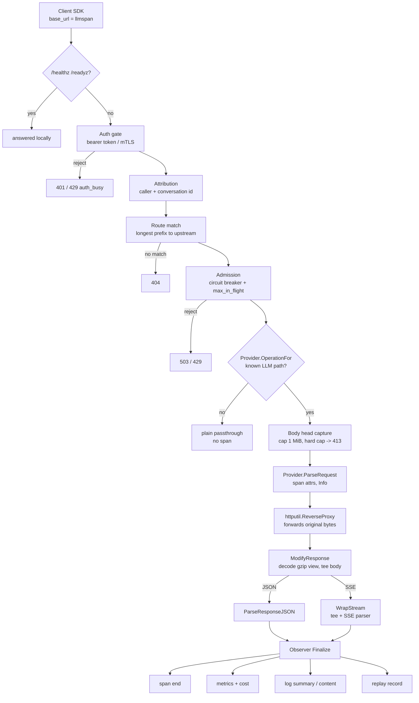

# Architecture

llmspan is a single Go binary: an HTTP reverse proxy that sits between your
code and an LLM API, forwards bytes unchanged, and emits OpenTelemetry
traces, metrics and logs describing each call. This page is the map for
contributors. Concepts are stable; file names are the pointers. Read the
code for the details, they move faster than this document.

## Request flow

In prose, in the order the code runs (`internal/proxy/proxy.go`, `ServeHTTP`
then `dispatch`):

1. **Health probes** (`/healthz`, `/readyz`) are answered before anything
   else, so Kubernetes can probe without a token.
2. **Auth gate** (`internal/auth`). Argon2id-hashed bearer tokens in a
   dedicated header (default `X-LLMSPAN-Token`, so `Authorization` stays free
   for the provider key), optional mTLS. The token header is stripped before
   forwarding. Verification concurrency is bounded and failed tokens are negatively cached.
3. **Attribution.** The caller is, in priority order: named token, the
   configured attribution header, mTLS common name, token fingerprint. An
   optional conversation header becomes `gen_ai.conversation.id` (span-only).
   Both headers are stripped before the request leaves.
4. **Route match and path canonicalisation.** Longest path-segment prefix
   picks the `upstream` from config; `strip_prefix` decides what the upstream
   sees. Each upstream owns one `reverse proxy` with its own transport
   (timeouts, optional certificate pinning).
5. **Admission.** Per-upstream circuit breaker (`breaker.go`: closed, open,
   half-open) and `max_in_flight`. Every exit past this point goes through
   `admission.release`, which feeds the final status back to the breaker.
6. **Operation check.** `Provider.OperationFor(path)` returns `""` for paths
   llmspan does not understand (`/v1/files`, model listings). Those are
   forwarded without a span. This is the passthrough guarantee: enrichment is
   best-effort, the data path is not.
7. **Body head capture** (`captureHeadAndForward`). At most 1 MiB is buffered
   for parsing; the rest streams through untouched. A global semaphore bounds
   how many heads are buffered at once. Oversized bodies are forwarded but get
   only the metadata visible in the head.
8. **Provider parse.** `ParseRequest` fills a vendor-neutral `provider.Info`
   and the span's request attributes.
9. **Reverse proxy.** The original bytes go upstream. `encoding.go` narrows
   `Accept-Encoding` and decodes gzip for the observer only; the client
   still receives exactly what the upstream sent.
10. **Response tee** (`observer.go` `ModifyResponse`). Non-streaming bodies
    are parsed on close. SSE bodies are wrapped by the provider's
    `WrapStream`: the parser sees bytes as they pass, with no goroutine per
    stream and no full-body buffering. An idle-body watchdog force-closes
    stalled upstream streams.
11. **Finalize** (idempotent). Ends the span with a spec-shaped name, records
    metrics and cost, writes the summary log, and appends to the replay file
    if recording is on. Client cancels are classified as 499, not as upstream
    faults.

## Package map

| Package | Role |
|---|---|
| `cmd/llmspan` | CLI: `up`, `check`, `healthcheck`, `demo`, `gen-cert`, `replay`, `diff`, `hash-token`, `version` |
| `internal/config` | YAML + env config, strict validation, token file parsing |
| `internal/auth` | Token hashing/verification, shape checks, failure cache |
| `internal/proxy` | HTTP handler, server, breaker, observer, self-metrics, TLS cert reload |
| `internal/provider` | Provider interface, OpenAI / Anthropic / Gemini parsers, SSE parser, content capture |
| `internal/genai` | Constants: attribute keys, metric names, bucket boundaries, span naming |
| `internal/telemetry` | OTel SDK setup, OTLP exporters, GenAI instruments, priority sampler |
| `internal/pricing` | Embedded price table (`prices.yaml`), cost computation, override file |
| `internal/redact` | Redaction profiles and JSON-aware body redaction |
| `internal/labels` | Cardinality caps and normalisation for metric labels (model, caller) |
| `internal/replay` | Redacted JSONL record/replay format |
| `internal/buildinfo` | Version, commit, date injected at link time |
| `deploy/` | Compose demo stack, Helm chart, Kubernetes manifests, Grafana dashboard and alerts |
| `test/` | Load harness (build tag `loadtest`) and compose smoke test |

The dependency direction is `proxy -> provider, telemetry, pricing, redact,
labels, genai`. `provider` never imports `proxy`.

## Telemetry signals

- **Spans.** One CLIENT span per enriched call named `{operation} {model}`,
  following the OpenTelemetry GenAI conventions. The inbound `traceparent` is
  extracted (W3C Trace Context), so the llmspan span joins the caller's trace.
- **Metrics.** The GenAI client metrics (duration, time to first chunk, token
  usage, operation token histograms) plus llmspan extensions (cost in USD,
  upstream time to first byte) and proxy self-metrics (`llmspan.*`: requests,
  rejects by reason, breaker state, active streams, pricing misses, export
  errors, cert expiry). Model and caller labels are cardinality-capped and
  overflow to `_other`. Some pre-spec names are still emitted and marked
  deprecated; the authoritative list is
  [SEMCONV-COMPLIANCE.md](SEMCONV-COMPLIANCE.md).
- **Logs.** A per-request summary log, and optionally prompt/completion
  content through the OTel log bridge.
- **Self-exposition.** Proxy self-metrics are also served in Prometheus text
  format by `MetricsHandler` (`selfexpo.go`).

## Sampling

Spans are always recorded in-process; an export-time filter
(`internal/telemetry/priority_exporter.go`) decides what leaves. Errors, 5xx,
expensive and slow spans are always kept; the rest follow a deterministic
trace-ID `sample_ratio`. A priority trace is promoted in a bounded set so the
llmspan span and its parent stay together. Metrics and logs are never sampled.
This is not tail sampling; for cross-service keep-the-whole-trace semantics use
a collector. Rationale and trade-offs:
[ADR 0001](adr/0001-priority-sampling.md).

## Redaction and recording

Content capture is off by default (`content.mode: off`). With `events` or
`logs`, every captured string passes through the configured redaction profile
(`off`, `default`, `strict`) before it touches a span or log, and redaction runs
before truncation. `internal/redact` handles raw JSON text and escape
sequences, and is fuzzed for idempotence. The optional `recording.path` JSONL
file applies the same profile to request, response and URL, and is written
with mode 0600. `llmspan replay` and `llmspan diff` consume it.

## Pricing

Cost is computed in the observer from `provider.Info` token counts and the
embedded table in `internal/pricing/prices.yaml` (longest model-prefix match
via a trie; cache read/write rates; long-context tiers). A token-bearing
response that cannot be priced increments `llmspan.pricing.misses.total` rather than
silently reporting zero. A YAML override can model negotiated rates. Sources
and known gaps are in [PRICING.md](PRICING.md).

## Security boundaries

- llmspan sees provider credentials and prompts. Default listen address is
  loopback; a non-loopback bind requires auth or an explicit acknowledgement.
- Provider API keys are forwarded, never logged or stored. The llmspan token
  header and attribution headers are stripped before the upstream sees them.
- Prompt and completion bytes reach telemetry only with capture on, after
  redaction. Error messages and logs do not echo bodies.
- Everything is bounded: head buffer, concurrent buffers, in-flight requests,
  attribute sizes, SSE event size, recording file size, label cardinality.
- Optional upstream certificate pinning and hot-reloaded server certificates.

Vulnerability reporting: [SECURITY.md](../SECURITY.md).

## Design non-goals

llmspan is an observe-only proxy, not a gateway. It deliberately does not:

- route or load-balance across providers, retry, or fail over;
- hold, mint, rotate or inject provider API keys (clients bring their own);
- cache, rewrite, rate-limit by tokens, or enforce budgets;
- run evals, scoring, or prompt management;
- ship a UI. Dashboards and alerts are Grafana assets in `deploy/grafana`.

If a feature changes what the client's request or response contains, it
probably does not belong here.

## Where to go next

- Add a provider: [ADDING_A_PROVIDER.md](ADDING_A_PROVIDER.md)
- Performance numbers and how to reproduce them: [BENCHMARKS.md](BENCHMARKS.md)
- Contribution workflow: [CONTRIBUTING.md](../CONTRIBUTING.md)
